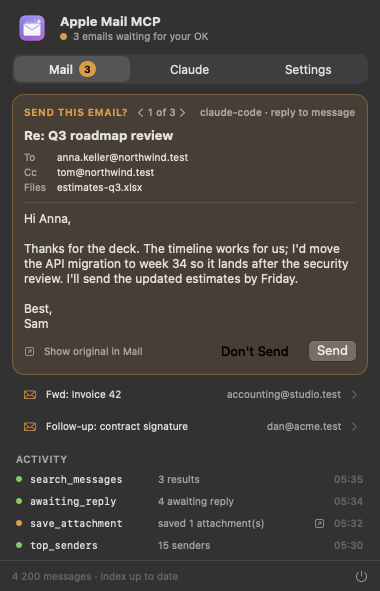
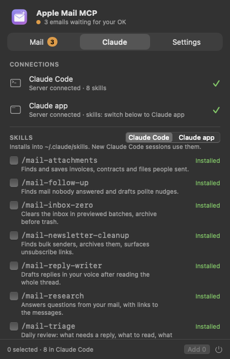
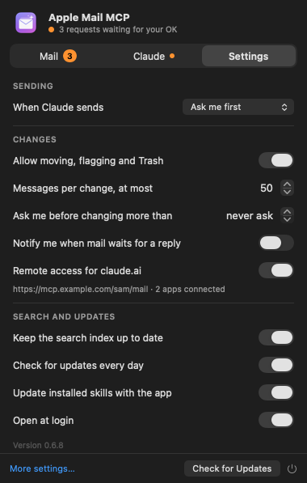
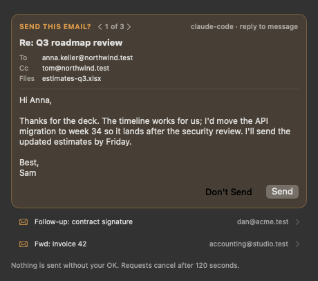

<p align="center">
  
</p>

<h1 align="center">Apple Mail MCP</h1>

<p align="center">
  Let Claude read, search, sort and answer your Apple Mail: fast, local, and with you in control of what gets sent.
</p>

<p align="center">
  <a href="https://github.com/mp-consulting/apple-mail-mcp/releases/latest"></a>
  <a href="https://github.com/mp-consulting/apple-mail-mcp/actions/workflows/ci.yml"></a>
  
  
  <a href="LICENSE"></a>
</p>

Apple Mail MCP is an [MCP](https://modelcontextprotocol.io) server for the Mail app on your Mac, plus a small
menu bar app. Claude (Claude Code, the Claude app, or any MCP client) can search years of mail in
milliseconds, read threads, find what needs a reply, draft answers in your voice, clean up newsletters and
file attachments, and it can only send an email after you click **Send**.

<p align="center">
  
  
  
</p>

## Why another Mail server?

Most Mail servers drive Mail with AppleScript for everything, including reading. Mail then walks its
mailboxes one message at a time, so a search through a large inbox takes minutes or times out, and Mail
freezes meanwhile.

Apple Mail MCP reads Mail's own database and message files directly, the same data Mail shows you, and only
talks to Mail to change something (move, flag, draft, send). Searches stay fast on any mailbox size and
never disturb Mail. See [Benchmarks](#benchmarks).

- **Fast on big mailboxes**: tens of milliseconds for searches, threads and statistics over 80,000+ messages.
- **Full-text search** of message bodies through a local index, built in about a minute.
- **Safe by default**: replies and new mail are saved as drafts; with "Ask me first" nothing is sent
  without your click; bulk changes have previews and limits; nothing is ever permanently deleted.
- **Smart views** out of the box: what needs your reply, what you're still waiting on, top senders, weekly stats.
- **Eight Claude skills** that turn the tools into workflows: triage, inbox zero, follow-ups, a reply writer
  that matches your voice, newsletter cleanup, research, attachments and a weekly report.
- **No passwords, no cloud**: it works with every account Mail has (iCloud, Gmail, Exchange, IMAP) and
  everything stays on your Mac.

## Install

1. Download **AppleMailMCP-x.y.z.dmg** from the [latest release](https://github.com/mp-consulting/apple-mail-mcp/releases/latest)
   and drag **Apple Mail MCP** to Applications. Open it: an envelope appears in the menu bar.
2. Click the envelope, open the **Claude** tab and click **Connect** next to Claude Code and/or the Claude app.
   - **Claude Code** gets the server and all the skills; new sessions see them.
   - **The Claude app** reads its servers only at launch: click **Restart Claude** when the tab offers it.
     For its skills, switch the Skills list to **Claude app** and click **Export**, then upload each `.zip` in
     Claude › Settings › Capabilities › Skills.
3. Give macOS permissions (one time, see [Permissions](#permissions)).

From a terminal, the same setup is:

```sh
"/Applications/Apple Mail MCP.app/Contents/MacOS/apple-mail-mcp" install        # Claude Code and the Claude app
"/Applications/Apple Mail MCP.app/Contents/MacOS/apple-mail-mcp" skills install # skills for Claude Code
```

Any other MCP client: run `/Applications/Apple Mail MCP.app/Contents/MacOS/apple-mail-mcp` as a stdio server.

### Permissions

macOS asks for two permissions, for the **app that starts the server** (Claude, your terminal, VS Code…):

| Permission | Why | Where |
|---|---|---|
| **Full Disk Access** | Read Mail's database and message files | System Settings › Privacy & Security › Full Disk Access |
| **Automation › Mail** | Move, flag, draft and send (asked the first time) | System Settings › Privacy & Security › Automation |

Give Full Disk Access to Apple Mail MCP too, for the panel's counts and the search index. If something is
missing, every tool answers with the exact app to allow, and the panel shows it under **Needs attention**.
Run `apple-mail-mcp doctor` for a full check.

## What Claude can do

| Tool | What it does |
|---|---|
| `inbox_overview` | Unread counts, latest unread, what needs a reply, flagged mail, in one call |
| `search_messages` | Any mix of text, subject, sender, recipient, **body**, mailbox, account, dates, unread, flags, attachments, Mail's categories; paginated |
| `get_message`, `get_thread` | A message or a whole conversation, with quotes stripped on request |
| `needs_response` | Mail from people, to you, still waiting on you (lists, promotions and no-reply excluded) |
| `awaiting_reply` | What you sent that nobody answered |
| `mail_statistics`, `top_senders` | Volume, busiest days and hours, categories, who writes most |
| `list_accounts`, `list_mailboxes` | Accounts, folders and counts |
| `list_attachments`, `save_attachment`, `export_messages` | Attachments to disk, messages to `.eml` or Markdown |
| `get_message_source` | Raw headers, e.g. to check authentication or unsubscribe links |
| `move_messages`, `update_messages`, `trash_messages`, `create_mailbox` | Archive and file, read/unread and flags, Trash; previews with `dry_run` |
| `compose_email`, `reply_to_message`, `forward_message` | Draft (default), open for review, or send |
| `open_in_mail`, `check_new_mail`, `body_index` | Show a message in Mail, fetch new mail, manage the search index |

Message ids are Mail's own; a moved message gets a new id, which `move_messages` returns.

## Skills

Pick them in the panel's **Claude** tab: each one shows what it does and whether it's installed.

| Skill | Or just ask… |
|---|---|
| `/mail-triage` | "What needs my attention in my mail today?" |
| `/mail-inbox-zero` | "Help me get my inbox to zero." |
| `/mail-follow-up` | "Who hasn't replied to me this week?" |
| `/mail-reply-writer` | "Reply to Anna's email about the roadmap." |
| `/mail-newsletter-cleanup` | "I get too many newsletters, clean that up." |
| `/mail-research` | "Find the confirmation code from my hotel booking." |
| `/mail-attachments` | "Save all invoices from 2025 into Documents/Invoices." |
| `/mail-weekly-report` | "How was my week in email?" |

Claude picks the right skill from your request; in Claude Code you can also start one with its slash command.
In the Claude app, skills are used automatically once uploaded.

They follow the same rules as the server: drafts before sending, previews before bulk changes, and quoting
as little of your mail as possible. When the app updates, skills you installed update with it.

## You stay in control

<p align="center">
  
</p>

When Claude wants to send, a small window pops up (and the panel's **Mail** tab shows a count). With several
emails waiting you review them one by one; nothing goes out without a click on **Send**.

- **Send policy** (Settings): *Ask me first* shows each outgoing email (recipients, subject, text,
  attachments) for **Send** or **Don't Send**; *Send right away*; or *Never send* (drafts only).
- **Drafts by default**: compose, reply and forward save to Drafts unless Claude is asked to send.
- **Batch limits**: at most 50 messages per change by default; `dry_run` previews moves and trash.
- **No permanent deletion**: Trash only, never emptied.
- **Files**: saved attachments can't go into startup, config or system folders; secrets (`~/.ssh`, `.env`,
  keychains, browser profiles, Mail's own data) can't be attached. Optional allowlists in Settings.
- **Read-only mode**: `apple-mail-mcp --read-only` offers only the reading tools.
- **Activity**: every tool call is listed in the Mail tab (never with message content).

## Benchmarks

Measured on an Apple M1 (16 GB) with a real mailbox of 83,600 messages, over MCP stdio like a client sees it.
Full tables: [Benchmarks/compare-python.md](Benchmarks/compare-python.md),
[Benchmarks/store-real.md](Benchmarks/store-real.md).

| Question (iCloud account, 81,600 messages) | Apple Mail MCP | Python apple-mail-mcp (AppleScript) |
|---|---:|---:|
| List accounts | 23 ms | 1.2 s |
| Unread counts per mailbox | 21 ms | 5.2 s |
| Latest 20 inbox messages | 34 ms | 4.3 s |
| Subject search, inbox | 48 ms | 5.0 s |
| Subject search, all mailboxes | 173 ms | 7.4 s |
| Sender search, inbox | 42 ms | 54 s |
| Top senders, 30 days | 16 ms | 39 s |
| Body text search, inbox | 45 ms | timed out (180 s) |
| Conversation thread | 56 ms | failed (Mail timed out) |
| Statistics · awaiting reply · needs response · overview | 38–45 ms | failed (Mail timed out) |

Median of 3 warm runs (one for Python), over MCP stdio. Without the body index, a body search scans
recent messages in parallel instead: 0.8 s for 2,000 messages. Building the index for the whole mailbox
takes about a minute.

Reproduce: `swift build -c release && .build/release/mail-bench compare` (needs `uvx` for the Python
server), `mail-bench store` for in-process timings on your mail, or `mail-bench synthetic --messages 100000`
for a generated mailbox that involves no personal data. CI runs the synthetic benchmark on every push.

## Command line

```text
apple-mail-mcp [--read-only] [--write-dir DIR] [--attach-dir DIR]   serve MCP over stdio
apple-mail-mcp doctor                                               check permissions, data, index
apple-mail-mcp index [--rebuild] [--prune]                          build or update the body index
apple-mail-mcp install | uninstall [claude-code | claude-desktop]   register with Claude
apple-mail-mcp skills [list | install | uninstall | export DIR]     manage the Claude skills
apple-mail-mcp call <tool> '{"json": "arguments"}'                  run one tool
```

Settings live in `~/Library/Application Support/apple-mail-mcp/settings.json` and are shared by the app and
every server (changes apply immediately).

## How it works

```text
Claude ──MCP (stdio)──▶ apple-mail-mcp ─┬─ reads ──▶ ~/Library/Mail/V10/MailData/Envelope Index (SQLite, read-only)
                                        │            .emlx files · local full-text index (FTS5)
                                        └─ writes ─▶ Apple Events ─▶ Mail.app ─▶ your accounts
Apple Mail MCP.app (menu bar) ── settings · approvals · activity · index updates · Claude setup · updates
```

- **MailStore** reads Mail's index (accounts, mailboxes, Gmail labels, flags, categories, threads) and parses
  messages (MIME, charsets, HTML to text) without Mail running.
- **MailAutomation** sends Apple Events built from Mail's scripting dictionary (no AppleScript), addressing
  messages by id, serialized across processes.
- **MailMCPKit** defines the tools, policies, approvals and skills; **MailMCPBar** is the SwiftUI menu bar app
  (Liquid Glass on macOS 26).

## Development

```sh
git clone https://github.com/mp-consulting/apple-mail-mcp && cd apple-mail-mcp
swift test --scratch-path ~/Library/Caches/apple-mail-mcp-build   # 120+ tests on synthetic mailboxes
Scripts/build-app.sh --install                                     # build, sign, install, launch the app
```

Requires Xcode 26 (Swift 6.2) for the app; the server builds with Swift 6.1. See [CLAUDE.md](CLAUDE.md)
for the architecture and the Mail quirks the code relies on, and [CHANGELOG.md](CHANGELOG.md) for releases.

## Credits

Inspired by [patrickfreyer/apple-mail-mcp](https://github.com/patrickfreyer/apple-mail-mcp), whose tool set
and path-guard rules shaped this one.

## License

[MIT](LICENSE) © 2026 Mickael Palma. Not affiliated with Apple. Apple Mail is a trademark of Apple Inc.
